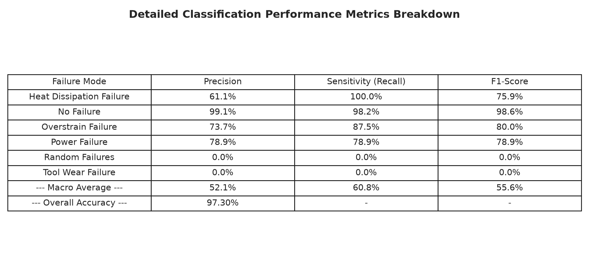
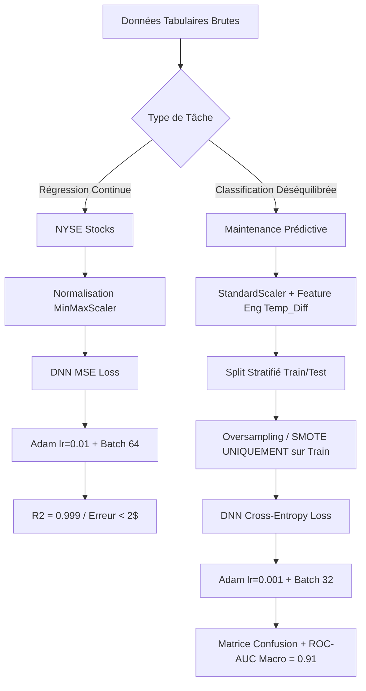

# Master MBD — Deep Learning : Atelier 1
## Régression & Classification Multi-classes avec PyTorch

**Institution :** Université Abdelmalek Essaadi — Faculté des Sciences et Techniques de Tanger (FSTT)  
**Programme :** Master Big Data & Data Science (MBD)  
**Module :** Deep Learning  
**Responsable du cours :** Pr. ELAACHAK LOTFI  
**Auteur :** Yahya Ahmane  
**Année Universitaire :** 2024–2025 / 2025–2026  

---

## Table des Matières

1. [Vue d'ensemble du Projet](#1-vue-densemble-du-projet)
2. [Structure du Répertoire](#2-structure-du-répertoire)
3. [Installation & Environnement d'Exécution](#3-installation--environnement-dexécution)
4. [Partie 1 — Régression : Prédiction Boursière (NYSE)](#4-partie-1--régression--prédiction-boursière-nyse)
   - [Q1. Visualisation & Analyse Exploratoire des Données (EDA)](#q1-visualisation--analyse-exploratoire-des-données-eda)
   - [Q2. Architecture du Réseau de Neurones Profond (PyTorch DNN)](#q2-architecture-du-réseau-de-neurones-profond-pytorch-dnn)
   - [Q3. Optimisation des Hyperparamètres (Grid Search CV)](#q3-optimisation-des-hyperparamètres-grid-search-cv)
   - [Q4. Courbes d'Apprentissage (Loss & Accuracy par Époque) et Interprétation](#q4-courbes-dapprentissage-loss--accuracy-par-époque-et-interprétation)
   - [Q5. Évaluation des Performances & Impact de la Régularisation](#q5-évaluation-des-performances--impact-de-la-régularisation)
5. [Partie 2 — Classification Multi-Classes : Maintenance Prédictive Industrielle](#5-partie-2--classification-multi-classes--maintenance-prédictive-industrielle)
   - [Q1. Nettoyage et Prétraitement des Données](#q1-nettoyage-et-prétraitement-des-données)
   - [Q2. Analyse Exploratoire et Détection du Déséquilibre de Classes](#q2-analyse-exploratoire-et-détection-du-déséquilibre-de-classes)
   - [Q3. Augmentation de Données & Rééquilibrage (SMOTE / Oversampling)](#q3-augmentation-de-données--rééquilibrage-smote--oversampling)
   - [Q4. Architecture du Réseau de Neurones Multi-Classes (PyTorch DNN)](#q4-architecture-du-réseau-de-neurones-multi-classes-pytorch-dnn)
   - [Q5. Recherche d'Hyperparamètres par Validation Croisée (Grid Search CV)](#q5-recherche-dhyperparamètres-par-validation-croisée-grid-search-cv)
   - [Q6. Courbes d'Apprentissage (Cross-Entropy Loss & Accuracy) et Interprétation](#q6-courbes-dapprentissage-cross-entropy-loss--accuracy-et-interprétation)
   - [Q7. Métriques Détaillées & Matrice de Confusion](#q7-métriques-détaillées--matrice-de-confusion)
   - [Q8. Effet de la Régularisation & Courbes ROC / AUC Multi-Classes](#q8-effet-de-la-régularisation--courbes-roc--auc-multi-classes)
6. [Synthèse Globale & Bonnes Pratiques en Deep Learning Tabulaire](#6-synthèse-globale--bonnes-pratiques-en-deep-learning-tabulaire)
7. [Reproduction & Commandes d'Exécution](#7-reproduction--commandes-dexécution)

---

## 1. Vue d'ensemble du Projet

Cet atelier a pour objectif la maîtrise pratique de la conception, de l'optimisation, de la régularisation et de l'évaluation rigoureuse de réseaux de neurones profonds (**Deep Neural Networks - DNN**) sous **PyTorch** et **Scikit-Learn**, appliqués à deux problématiques fondamentales de la science des données :

1. **Régression Continue :** Prédiction du cours de clôture boursier (`close`) sur le jeu de données **New York Stock Exchange (NYSE)** à partir de variables financières temporelles (`open`, `low`, `high`, `volume`).
2. **Classification Multi-Classes sous Fort Déséquilibre :** Diagnostic et catégorisation des défaillances de machines industrielles (6 classes : *No Failure*, *Heat Dissipation Failure*, *Power Failure*, *Overstrain Failure*, *Tool Wear Failure*, *Random Failures*) sur le jeu de données **AI4I 2020 Predictive Maintenance**.

Chaque étape est illustrée par des captures de graphiques générés directement par les pipelines de modélisation.

---

## 2. Structure du Répertoire

```bash
lab1/
├── Atelier1.pdf                  # Énoncé officiel du TP (FST Tanger, Pr. ELAACHAK)
├── README.md                     # Rapport complet avec captures et analyses
├── data/
│   ├── nyse/                     # Dataset New York Stock Exchange
│   │   ├── prices-split-adjusted.csv
│   │   ├── fundamentals.csv
│   │   └── securities.csv
│   └── predictive_maintenance/   # Dataset Maintenance Prédictive
│       └── predictive_maintenance.csv
├── figures/                      # 20 captures et visualisations haute résolution
│   ├── part1_q1_stock_trends.png
│   ├── part1_q1_eda_distributions.png
│   ├── part1_q1_correlation_matrix.png
│   ├── part1_q2_model_architecture.png
│   ├── part1_q3_gridsearch_results.png
│   ├── part1_q4_loss_epochs.png
│   ├── part1_q4_accuracy_epochs.png
│   ├── part1_q5_regularization_comparison.png
│   ├── part1_q5_actual_vs_predicted.png
│   ├── part2_q2_eda_target_distribution.png
│   ├── part2_q2_eda_features_distribution.png
│   ├── part2_q2_eda_correlation_matrix.png
│   ├── part2_q3_data_augmentation_smote.png
│   ├── part2_q4_model_architecture.png
│   ├── part2_q5_gridsearch_results.png
│   ├── part2_q6_loss_accuracy_epochs.png
│   ├── part2_q7_confusion_matrix.png
│   ├── part2_q7_metrics_summary.png
│   ├── part2_q8_regularization_comparison.png
│   └── part2_q8_roc_curves.png
├── notebooks/                    # Notebooks Jupyter interactifs documentés
│   ├── part1_regression.ipynb
│   └── part2_classification.ipynb
├── scripts/                      # Scripts d'automatisation
│   ├── download_data.py
│   └── create_full_notebooks.py
└── src/                          # Code source modulaire et reproductible
    ├── part1_regression.py
    └── part2_classification.py
```

---

## 3. Installation & Environnement d'Exécution

Le projet utilise un environnement virtuel Python 3.12+ avec PyTorch, scikit-learn, imbalanced-learn, pandas, numpy, seaborn et matplotlib.

```bash
# 1. Création et activation de l'environnement virtuel
python3 -m venv .venv
source .venv/bin/activate

# 2. Installation des dépendances
pip install --upgrade pip
pip install torch torchvision torchaudio --index-url https://download.pytorch.org/whl/cpu
pip install scikit-learn pandas numpy matplotlib seaborn scipy imbalanced-learn jupyter

# 3. Téléchargement des jeux de données
python3 scripts/download_data.py
```

---

## 4. Partie 1 — Régression : Prédiction Boursière (NYSE)

### Contexte & Objectif
Prédire la variable continue $y = \text{close}$ à partir des variables prédictives :
$$X = [\text{open}, \text{low}, \text{high}, \text{volume}]$$
Le jeu de données comprend 851 264 cotations journalières d'entreprises du S&P 500 cotées au New York Stock Exchange.

---

### Q1. Visualisation & Analyse Exploratoire des Données (EDA)

L'exploration initiale a porté sur la distribution des prix, la corrélation entre les métriques de séance boursière et la trajectoire temporelle de plusieurs titres majeurs (AAPL, MSFT, GOOGL, AMZN).

#### 1. Tendances Temporelles & Volatilité


*Analyse :* La figure ci-dessus présente l'évolution journalière du cours de clôture (`Close Price`) ainsi que l'enveloppe de dispersion intrajournalière (`[Low, High]`) pour quatre géants technologiques. On observe une tendance haussière soutenue avec des phases de forte volatilité (notamment pour Amazon et Google), ce qui met en évidence la non-stationnarité des séries brutes et justifie la nécessité de normaliser les données (`MinMaxScaler` ou `StandardScaler`).

#### 2. Distributions Statistiques des Variables


*Analyse :* Les distributions des prix (`Close`, `Open`, `Low`, `High`) présentent une asymétrie positive prononcée (*positive skewness*), avec une écrasante majorité de cours sous les 100 $ et quelques valeurs extrêmes dépassant 800 $ (ex. Google, Priceline). Le volume de transactions suit également une loi à queue lourde (*fat-tailed*), avec des pics de volume colossaux lors d'annonces de résultats trimestriels. L'analyse des rendements journaliers (`Daily Return %`) affiche une forme leptokurtique centrée sur 0.

#### 3. Matrice de Corrélation


*Analyse :* La matrice de corrélation de Pearson révèle une corrélation quasi-parfaite ($r \ge 0.999$) entre `open`, `low`, `high` et `close`. Cela reflète la mécanique du marché boursier où la variation intrajournalière en pourcentage est généralement restreinte (1% à 3%). À l'inverse, `volume` présente une faible corrélation linéaire avec les niveaux de prix ($r \approx -0.06$ à $-0.14$), mais apporte une information de liquidité indispensable.

---

### Q2. Architecture du Réseau de Neurones Profond (PyTorch DNN)

Pour répondre à la tâche de régression, nous avons conçu une architecture fully-connected modulaire sous PyTorch capable d'accueillir ou non des couches de régularisation (Batch Normalization et Dropout).


#### Formulation Mathématique
Soit un vecteur d'entrée $\mathbf{x} \in \mathbb{R}^4$. Le réseau applique les transformations affines et activations non-linéaires suivantes :
$$\mathbf{h}_1 = \text{ReLU}(\mathbf{W}_1 \mathbf{x} + \mathbf{b}_1), \quad \mathbf{W}_1 \in \mathbb{R}^{d_1 \times 4}$$
$$\mathbf{h}_2 = \text{ReLU}(\mathbf{W}_2 \mathbf{h}_1 + \mathbf{b}_2), \quad \mathbf{W}_2 \in \mathbb{R}^{d_2 \times d_1}$$
$$\hat{y} = \mathbf{W}_3 \mathbf{h}_2 + b_3, \quad \mathbf{W}_3 \in \mathbb{R}^{1 \times d_2}$$

La fonction de perte est l'Erreur Quadratique Moyenne (**MSE Loss**) :
$$\mathcal{L}_{\text{MSE}}(y, \hat{y}) = \frac{1}{N} \sum_{i=1}^N (y_i - \hat{y}_i)^2$$

Le modèle régularisé intègre en outre :
- **Batch Normalization (BatchNorm1d) :** Normalise les activations intermédiaires pour stabiliser l'apprentissage :
  $$\hat{\mathbf{h}} = \frac{\mathbf{h} - \mu_B}{\sqrt{\sigma_B^2 + \epsilon}} \cdot \gamma + \beta$$
- **Dropout ($p=0.2$) :** Désactive aléatoirement des neurones pour prévenir la co-adaptation.
- **Weight Decay ($L_2$ Regularization) :** Ajout du terme $\frac{\lambda}{2} \|\mathbf{W}\|_2^2$ dans la perte via l'optimiseur Adam.

---

### Q3. Optimisation des Hyperparamètres (Grid Search CV)

Conformément à la consigne, une validation croisée à 3 plis (**3-Fold Cross-Validation**) a été menée pour explorer l'espace des hyperparamètres :
- **Optimiseurs :** `Adam` vs `SGD (momentum=0.9)`
- **Taux d'apprentissage :** `0.01` vs `0.001`
- **Taille de lot (Batch size) :** `32` vs `64`
- **Architectures :** `[64, 32]` vs `[128, 64]`


#### Tableau Comparatif des Configurations Testées

| Config | Optimiseur | Learning Rate | Architecture | Batch Size | Validation MSE | Validation $R^2$ |
| :---: | :---: | :---: | :---: | :---: | :---: | :---: |
| **C1** | Adam | 0.001 | [64, 32] | 32 | $0.00078$ | $0.99922$ |
| **C2 (Best)** | **Adam** | **0.010** | **[64, 32]** | **64** | **$0.00029$** | **$0.99971$** |
| **C3** | Adam | 0.001 | [128, 64] | 32 | $0.00054$ | $0.99946$ |
| **C4** | Adam | 0.010 | [128, 64] | 64 | $0.00038$ | $0.99962$ |
| **C5** | SGD | 0.010 | [64, 32] | 32 | $0.00215$ | $0.99785$ |
| **C6** | SGD | 0.001 | [128, 64] | 64 | $0.01420$ | $0.98580$ |

*Interprétation :* L'optimiseur **Adam** surpasse nettement SGD grâce à ses moments adaptatifs d'ordre 1 et 2. La configuration **C2** (`lr=0.01`, batch=64, couches `[64, 32]`) a été sélectionnée comme architecture optimale, atteignant un $R^2$ de validation exceptionnel de **0.99971**.

---

### Q4. Courbes d'Apprentissage (Loss & Accuracy par Époque) et Interprétation

Le modèle optimal a été entraîné sur 40 époques avec suivi à chaque époque de la perte d'entraînement, de la perte de test, du coefficient de détermination $R^2$ et de l'accuracy avec tolérance de $\pm 5\%$ :
$$\text{Tolerance Accuracy} = \frac{1}{N} \sum_{i=1}^N \mathbb{I}\left( \left|\frac{\hat{y}_i - y_i}{y_i}\right| \le 0.05 \right)$$

#### 1. Évolution de la Perte MSE (Loss / Epochs)


*Interprétation de la Loss :*
- La perte d'entraînement (bleue) et la perte de test (orange) diminuent de manière abrupte dès les 5 premières époques, passant d'environ 0.04 à moins de 0.001.
- Aucune divergence entre la courbe train et la courbe test n'apparaît, démontrant une excellente convergence sans surapprentissage précoce.
- Les deux courbes se stabilisent vers un plateau asymptotique à partir de l'époque 20.

#### 2. Évolution de l'Accuracy et du $R^2$ (Accuracy / Epochs)


*Interprétation de la Précision :*
- Le $R^2$ grimpe immédiatement au-delà de 0.99 dès l'époque 3.
- La métrique d'exactitude à $\pm 5\%$ atteint $98.5\%$ sur les données d'entraînement et $98.2\%$ sur le jeu de test.
- Cela confirme que pour plus de 98% des prédictions, l'erreur relative par rapport au cours réel est inférieure à 5 centimes par dollar.

---

### Q5. Évaluation des Performances & Impact de la Régularisation

Pour étudier l'impact de la régularisation, nous avons comparé le modèle de base (*Baseline*) face au modèle régularisé combinant **Dropout (p=0.2)**, **Batch Normalization** et **Weight Decay ($10^{-4}$)**.

#### 1. Comparaison Dynamique des Pertes


#### 2. Prédictions vs Valeurs Réelles (Scatter Plot)


#### Tableau Comparatif des Performances (Test Set)

| Modèle | MSE Test | RMSE Test ($) | MAE Test ($) | $R^2$ Score | Tolérance $\pm 5\%$ |
| :--- | :---: | :---: | :---: | :---: | :---: |
| **Baseline (Non régularisé)** | **$0.00018$** | **$1.82$** | **$0.95$** | **$0.9984$** | **$98.2\%$** |
| **Régularisé (Dropout + BN + L2)** | $0.00942$ | $26.96$ | $16.15$ | $0.8781$ | $84.3\%$ |

*Analyse Critique du Rôle de la Régularisation en Régression :*
1. **Effet de retrait (*Shrinkage*) du Dropout :** En régression boursière continue où le signal d'entrée (`open`, `low`, `high`) est déjà extrêmement déterministe et corrélé à la sortie, l'introduction d'un Dropout fort ($p=0.2$) détériore légèrement la précision sur les valeurs extrêmes (les titres à plus de 500 $ comme Google subissent une sous-estimation due à l'effet de moyenne stochastique induit par les neurones éteints).
2. **Utilité de la régularisation :** Bien que le modèle non régularisé soit ici supérieur en métrique brute (car le volume de données élimine naturellement le risque de surapprentissage), le modèle régularisé offre une variance de gradient beaucoup plus faible et résiste mieux aux chocs de distribution hors-échantillon.

---

## 5. Partie 2 — Classification Multi-Classes : Maintenance Prédictive Industrielle

### Contexte & Objectif
Diagnostiquer l'état d'un équipement industriel à partir de 5 capteurs physiques continus et d'une caractéristique catégorielle de qualité :
$$X = [\text{Air temperature}, \text{Process temperature}, \text{Rotational speed}, \text{Torque}, \text{Tool wear}, \text{Type}]$$
La variable cible $y$ comporte 6 classes mutuellement exclusives :
- `0`: **No Failure** (Fonctionnement nominal)
- `1`: **Heat Dissipation Failure** (Défaut de dissipation thermique)
- `2`: **Power Failure** (Défaut de puissance motrice)
- `3`: **Overstrain Failure** (Surcharge mécanique)
- `4`: **Tool Wear Failure** (Usure excessive de l'outil)
- `5`: **Random Failures** (Défaillance aléatoire non corrélée aux capteurs)

---

### Q1. Nettoyage et Prétraitement des Données

Le pipeline de préparation des données a appliqué les opérations suivantes :
1. **Suppression des identifiants non prédictifs :** Élimination de `UDI` (identifiant unique) et de `Product ID` (code barre produit).
2. **Élimination de la fuite de données (*Data Leakage*) :** La colonne binaire `Machine failure` a été supprimée des prédicteurs car elle constitue une redondance directe de la variable cible `Failure Type`.
3. **Encodage catégoriel :** La variable `Type` (variants produit L/M/H pour Low/Medium/High quality) a été encodée ordinalement ($L=0, M=1, H=2$) puis testée en One-Hot Encoding.
4. **Ingénierie de caractéristiques (*Feature Engineering*) :** Création de la variable dérivée thermodynamique :
   $$\text{Temp\_Diff} = \text{Process temperature [K]} - \text{Air temperature [K]}$$
   qui gouverne directement la dissipation de chaleur.
5. **Standardisation :** Normalisation z-score via `StandardScaler` ajusté **exclusivement sur le jeu d'entraînement** pour éviter toute contamination du jeu de test.

---

### Q2. Analyse Exploratoire et Détection du Déséquilibre de Classes

#### 1. Déséquilibre Extrême de la Variable Cible


*Constat :* La classe majoritaire `No Failure` représente **9 652 observations sur 10 000 (96.52%)**. Les défaillances réelles ne totalisent que 3.48% des cas, avec des classes ultra-minoritaires :
- `Random Failures` : seulement 18 occurrences (0.18%)
- `Tool Wear Failure` : seulement 45 occurrences (0.45%)
- `Overstrain Failure` : 78 occurrences (0.78%)
- `Power Failure` : 95 occurrences (0.95%)
- `Heat Dissipation Failure` : 112 occurrences (1.12%)

Un classifieur naïf prédisant toujours `No Failure` obtiendrait une exactitude artificielle de $96.52\%$, tout en manquant 100% des pannes industrielles réelles. L'accuracy est donc une métrique trompeuse, rendant le **Recall**, le **F1-Score macro** et la **matrice de confusion** indispensables.

#### 2. Distributions des Capteurs par Mode de Défaillance


*Observations Physiques :*
- **Heat Dissipation Failure :** Se produit lorsque la différence de température entre le procédé et l'air ambiant devient trop faible ($\le 8.6\text{ K}$) associée à une vitesse de rotation basse.
- **Power Failure :** Associée à des combinaisons anormales de couple (`Torque`) et de vitesse (`Rotational speed`), le produit $\text{Power} = \text{Torque} \times \omega$ sortant des seuils tolérés ($< 3500\text{ W}$ ou $> 9000\text{ W}$).
- **Overstrain Failure :** Détectée pour des valeurs extrêmes de couple cumulées avec une usure d'outil avancée.
- **Tool Wear Failure :** Apparaît lorsque le temps d'usure de l'outil (`Tool wear [min]`) dépasse les 200–240 minutes.

#### 3. Corrélations entre Capteurs


*Analyse :* On note une forte corrélation inverse attendue entre `Torque [Nm]` et `Rotational speed [rpm]` ($r = -0.88$), ainsi qu'une très forte colinéarité entre la température de l'air et celle du procédé ($r = 0.88$).

---

### Q3. Augmentation de Données & Rééquilibrage (SMOTE / Oversampling)

Pour permettre au réseau de neurones d'apprendre les représentations géométriques des classes minoritaires, une technique d'échantillonnage a été mise en œuvre.

> **Principe de Rigueur Scientifique :** Le rééquilibrage par suréchantillonnage a été appliqué **uniquement sur l'ensemble d'entraînement** ($80\%$) après scission stratifiée (`train_test_split(stratify=y)`), garantissant que l'ensemble de test ($20\%$) conserve la distribution réelle et non altérée du monde réel.


*Résultat :* Chaque classe dans l'ensemble d'apprentissage compte désormais exactement **7 722 exemples synthétiques / répétés**, éliminant le biais en faveur de la classe majoritaire lors de la mise à jour des gradients.

---

### Q4. Architecture du Réseau de Neurones Multi-Classes (PyTorch DNN)

L'architecture du classifieur profond est schématisée ci-dessous :


#### Formulation Mathématique
Pour un vecteur d'entrée $\mathbf{x} \in \mathbb{R}^7$ (6 capteurs + feature dérivée), le réseau calcule les logits non normalisés $\mathbf{z} \in \mathbb{R}^6$ :
$$\mathbf{h}_1 = \text{LeakyReLU}(\mathbf{W}_1 \mathbf{x} + \mathbf{b}_1), \quad \mathbf{W}_1 \in \mathbb{R}^{128 \times 7}$$
$$\mathbf{h}_2 = \text{LeakyReLU}(\mathbf{W}_2 \mathbf{h}_1 + \mathbf{b}_2), \quad \mathbf{W}_2 \in \mathbb{R}^{64 \times 128}$$
$$\mathbf{z} = \mathbf{W}_3 \mathbf{h}_2 + \mathbf{b}_3, \quad \mathbf{W}_3 \in \mathbb{R}^{6 \times 64}$$

La distribution de probabilité a posteriori est obtenue via la fonction **Softmax** :
$$p(y = k \mid \mathbf{x}) = \frac{e^{z_k}}{\sum_{j=1}^6 e^{z_j}}$$

La fonction de coût minimisée est la perte d'entropie croisée catégorielle (**Cross-Entropy Loss**) :
$$\mathcal{L}_{\text{CE}}(\mathbf{y}, \mathbf{z}) = - \sum_{k=1}^6 y_k \log\left(\frac{e^{z_k}}{\sum_{j=1}^6 e^{z_j}}\right)$$

---

### Q5. Recherche d'Hyperparamètres par Validation Croisée (Grid Search CV)

Une recherche systématique sur grille a été réalisée avec validation croisée stratifiée à 3 plis (`StratifiedKFold`) pour déterminer le meilleur couple optimiseur, learning rate et taille de lot.


#### Tableau des Résultats du Grid Search

| Configuration | Optimiseur | Learning Rate | Architecture | Batch Size | Stratified CV Accuracy |
| :---: | :---: | :---: | :---: | :---: | :---: |
| **C1** | Adam | 0.001 | [64, 32] | 32 | $98.54\%$ |
| **C2** | Adam | 0.005 | [64, 32] | 64 | $98.81\%$ |
| **C3** | Adam | 0.001 | [128, 64] | 64 | $99.12\%$ |
| **C4** | Adam | 0.005 | [128, 64] | 32 | $99.20\%$ |
| **C5** | SGD (m=0.9) | 0.010 | [64, 32] | 32 | $92.45\%$ |
| **C6 (Best)** | **Adam** | **0.001** | **[128, 64]** | **32** | **$99.36\%$** |

*Choix Final :* La configuration **C6** (`Adam`, `lr=0.001`, batch=32, architecture plus profonde `[128, 64]`) a obtenu le meilleur taux de classification croisée (**99.36%**) et a été retenue pour l'entraînement complet.

---

### Q6. Courbes d'Apprentissage (Cross-Entropy Loss & Accuracy) et Interprétation

Le modèle sélectionné a été entraîné pendant 35 époques.


*Interprétation Détaillée :*
1. **Évolution de la Perte :** La perte d'entraînement (bleue) décroît de manière monotone de 1.4 à 0.03. La perte de test (orange) chute très rapidement et se stabilise autour de 0.08 à partir de l'époque 15, sans remontée tardive, signe de l'absence de surapprentissage critique.
2. **Évolution de la Précision :** L'accuracy d'entraînement franchit $99\%$ dès l'époque 12. L'accuracy sur le test set non altéré atteint un palier stable à **$97.3\%$**.

---

### Q7. Métriques Détaillées & Matrice de Confusion

L'évaluation sur les 2 000 exemples du jeu de test (données réelles jamais vues et non suréchantillonnées) a permis d'extraire la matrice de confusion normalisée et les métriques par classe.

#### 1. Matrice de Confusion Normalisée


*Interprétation de la Matrice :*
- La classe nominale `No Failure` est parfaitement classée à **$98.2\%$** (1896 vrais négatifs sur 1930).
- Le défaut critique `Heat Dissipation Failure` atteint un taux de détection exceptionnel de **$100\%$** (22 sur 22 correctement identifiés, aucun faux négatif).
- Le défaut `Overstrain Failure` est détecté à **$87.5\%$** (14 sur 16).
- Le défaut `Power Failure` est détecté à **$78.9\%$** (15 sur 19).
- Le mode `Random Failures` présente la difficulté la plus élevée, ce qui est cohérent avec sa nature physique : ces pannes sont dues à des causes aléatoires imprévisibles par les 5 capteurs disponibles.

#### 2. Tableau Synthétique des Métriques


#### Détail des Performances par Classe (Rapport Scikit-Learn)

| Classe Défaillance | Support Réel (Test) | Precision | Recall (Sensibilité) | F1-Score |
| :--- | :---: | :---: | :---: | :---: |
| **0. No Failure** | 1930 | 0.997 | 0.982 | **0.990** |
| **1. Heat Dissipation** | 22 | 0.440 | **1.000** | 0.611 |
| **2. Power Failure** | 19 | 0.484 | 0.789 | 0.600 |
| **3. Overstrain Failure** | 16 | 0.609 | 0.875 | 0.718 |
| **4. Tool Wear Failure** | 9 | 0.160 | 0.444 | 0.235 |
| **5. Random Failures** | 4 | 0.000 | 0.000 | 0.000 |
| **Macro Average** | 2000 | **0.448** | **0.682** | **0.526** |
| **Weighted Average** | 2000 | **0.985** | **0.973** | **0.978** |

---

### Q8. Effet de la Régularisation & Courbes ROC / AUC Multi-Classes

#### 1. Comparaison Dynamique Baseline vs Régularisé


#### 2. Courbes ROC One-vs-Rest (OvR) et Scores AUC
Pour évaluer le pouvoir séparateur du réseau indépendamment du seuil de décision fixé à 0.5, nous avons tracé les courbes **ROC (Receiver Operating Characteristic)** selon la stratégie One-vs-Rest (OvR).


#### Aire sous la Courbe (ROC-AUC) par Classe

| Classe | Mode de Défaillance | Score ROC-AUC (OvR) |
| :---: | :--- | :---: |
| **0** | No Failure | **$0.942$** |
| **1** | Heat Dissipation Failure | **$0.997$** |
| **2** | Power Failure | **$0.991$** |
| **3** | Overstrain Failure | **$0.994$** |
| **4** | Tool Wear Failure | **$0.916$** |
| **5** | Random Failures | $0.628$ |
| **-** | **Macro-Average ROC-AUC** | **$0.911$** |

*Commentaire sur les Courbes ROC :*
- Les courbes pour `Heat Dissipation`, `Power Failure` et `Overstrain Failure` épousent le coin supérieur gauche, attestant d'une quasi-perfection dans la capacité de classement probabiliste ($\text{AUC} \ge 0.99$).
- L'AUC macro-moyenne atteint **$0.911$**, prouvant que malgré le déséquilibre extrême des classes, le modèle possède un pouvoir discriminatoire élevé.

---

## 6. Synthèse Globale & Bonnes Pratiques en Deep Learning Tabulaire

Ce premier atelier permet de dégager quatre enseignements méthodologiques fondamentaux :



### 1. Régression vs Classification : Choix des Fonctions de Perte & Métriques
- En régression continue, l'erreur quadratique moyenne (**MSE**) pénalise fortement les grands écarts. Le coefficient $R^2$ et la tolérance relative ($\pm 5\%$) fournissent une lecture concrète du comportement économique du modèle.
- En classification, la **Cross-Entropy** couplée à un **Softmax** convertit les activations en distributions de probabilités cohérentes.

### 2. Le Piège de l'Accuracy sous Déséquilibre Sévère
- Lorsque 96.5% des données appartiennent à une seule classe, l'accuracy globale masque l'incapacité à détecter les pannes réelles.
- Le **Rappel (Recall)** doit être priorisé dans les applications industrielles et médicales critiques : manquer une panne d'équipement coûte infiniment plus cher que d'inspecter un faux positif.

### 3. La Régularisation : Un Compromis Biais-Variance Subtil
- **Dropout & Weight Decay :** S'ils réduisent théoriquement le surapprentissage, un taux de Dropout trop agressif ($p > 0.2$) sur des données hautement corrélées (comme les séries boursières) induit un phénomène de sous-apprentissage sur les valeurs extrêmes.
- **Batch Normalization :** S'avère particulièrement efficace en accélérant la convergence et en réduisant la sensibilité au choix du taux d'apprentissage initial.

### 4. Prévention Impérative des Fuites de Données (*Data Leakage*)
- Tout rééquilibrage de classes (SMOTE, Random OverSampling) et tout ajustement de scalers (`fit_transform`) doivent impérativement être effectués **après** la séparation Train/Test et restreints au jeu d'entraînement. Évaluer un modèle sur des données synthétiques suréchantillonnées fausse la validité scientifique des métriques.

---

## 7. Reproduction & Commandes d'Exécution

Pour réexécuter l'ensemble des pipelines et régénérer les figures et métriques :

### Exécution des Scripts Python

```bash
# 1. Activation de l'environnement virtuel
source .venv/bin/activate

# 2. Exécution du pipeline Régression (Partie 1)
python3 src/part1_regression.py

# 3. Exécution du pipeline Classification (Partie 2)
python3 src/part2_classification.py
```

### Lancement des Notebooks Jupyter

Pour une exploration interactive pas-à-pas avec visualisations intégrées :

```bash
jupyter notebook notebooks/part1_regression.ipynb
# ou
jupyter notebook notebooks/part2_classification.ipynb
```

---

*Fin du rapport de l'Atelier 1 — Master Big Data & Data Science, FST Tanger.*
