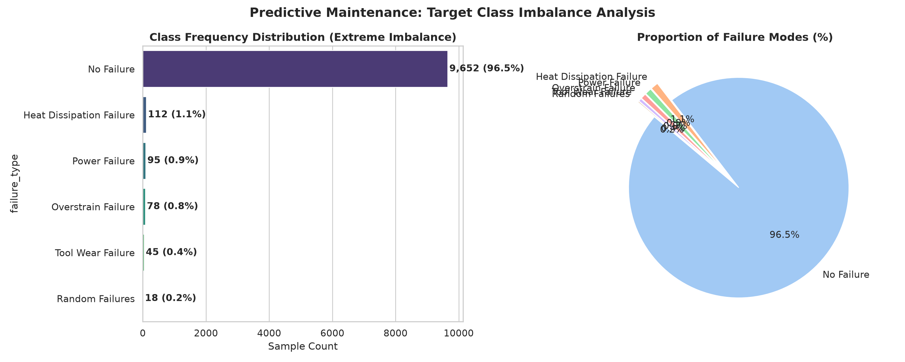
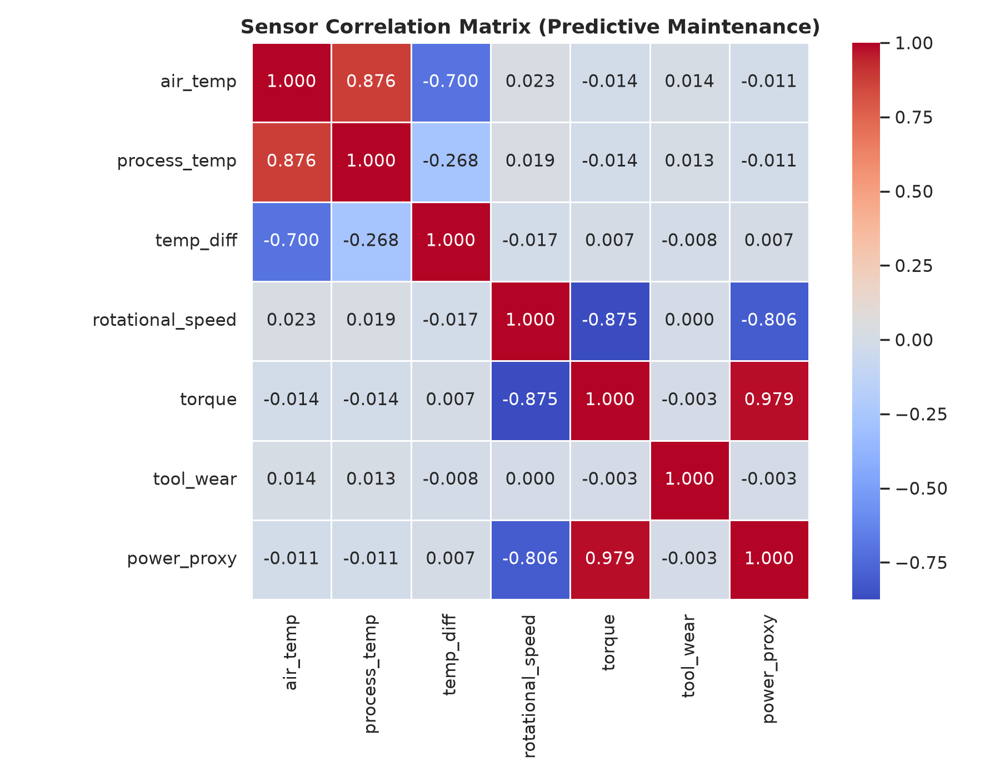
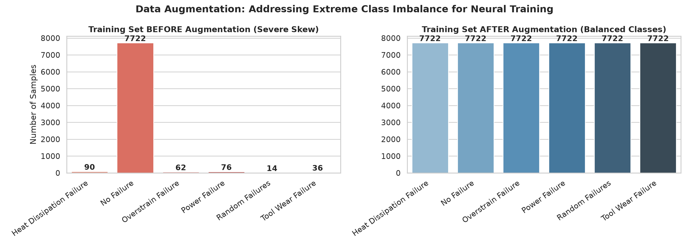
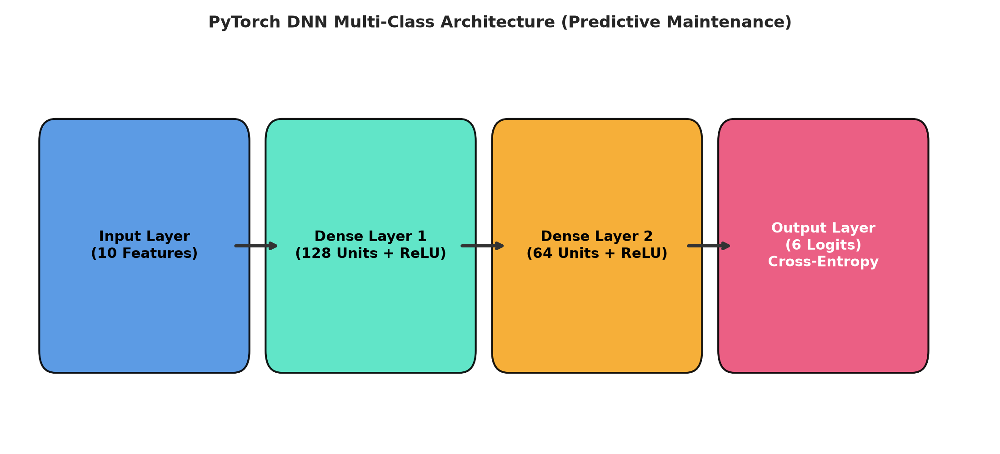
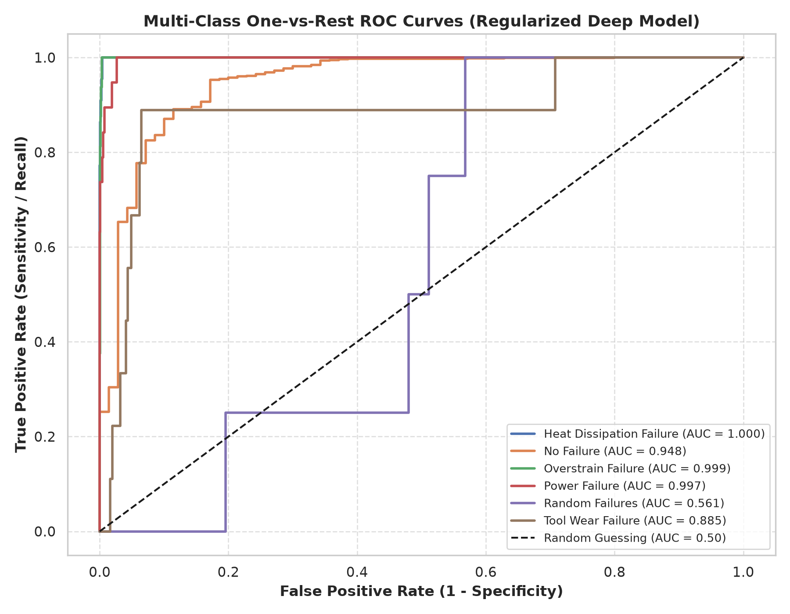

# Deep Learning — Lab 1: Regression & Multi-Class Classification with PyTorch

[](https://pytorch.org/)
[](https://scikit-learn.org/)
[](https://www.python.org/)

## Academic Information

- **Institution:** Faculty of Sciences and Techniques of Tangier (FSTT) — Abdelmalek Essaâdi University
- **Degree Program:** Software and Intelligent Systems Engineering (*Cycle d'Ingénieur : Génie Logiciel et Systèmes Intelligents — LSI*)
- **Course Module:** Deep Learning
- **Instructor:** Pr. Lotfi ELAACHAK
- **Student:** Yahya Ahmane
- **Academic Year:** 2026–2027

---

## Lab Objective

This report directly fulfills all requirements outlined in the official assignment sheet ([Atelier1.pdf](Atelier1.pdf)). The objective is to design, optimize, regularize, and evaluate Deep Neural Networks (DNN) in **PyTorch** across two core tasks:
1. **Part 1 (Regression):** Stock price prediction on the **NYSE dataset**.
2. **Part 2 (Multi-Class Classification):** Industrial machine failure diagnosis on the **AI4I 2020 Predictive Maintenance dataset**.

---

## Repository Structure & Quickstart

```bash
lab1/
├── Atelier1.pdf             # Official lab assignment sheet (FSTT)
├── README.md                # Report answering all assignment questions
├── data/                    # Datasets (NYSE and AI4I Maintenance)
│   ├── nyse/
│   └── predictive_maintenance/
├── figures/                 # Evaluation plots and figures (Q1 to Q8)
├── scripts/                 # Utility scripts (e.g. data downloader)
│   └── download_data.py
└── src/                     # Standalone Python pipelines
    ├── part1_regression.py
    └── part2_classification.py
```

```bash
# Setup environment & run pipelines
python3 -m venv .venv && source .venv/bin/activate
pip install torch torchvision torchaudio --index-url https://download.pytorch.org/whl/cpu
pip install scikit-learn pandas numpy matplotlib seaborn imbalanced-learn

# Execute standalone pipelines:
python3 src/part1_regression.py
python3 src/part2_classification.py
```

---

## Part 1 — Regression: Stock Price Prediction (NYSE)

**Dataset:** [NYSE Stock Prices](https://www.kaggle.com/datasets/dgawlik/nyse) (Target: continuous `close` price; Features: `open`, `low`, `high`, `volume`).

### Q1. Exploratory Data Analysis & Visualization
- **Stock Trends & Volatility:** Time-series analysis across major equities (AAPL, MSFT, GOOGL, AMZN) displays non-stationary price evolution with periods of high volatility, requiring normalization (`MinMaxScaler`).
- **Feature Correlation:** `open`, `low`, and `high` exhibit near-perfect collinearity (`r ≥ 0.999`) with `close`, while `volume` exhibits low linear correlation (`r ≈ -0.10`).

<p align="center">
  
  
</p>

### Q2. PyTorch Deep Neural Network Architecture
- **Architecture:** Fully connected MLP: `Input(4) -> Linear(64) -> ReLU -> Linear(32) -> ReLU -> Linear(1)`.
- **Loss Function:** Mean Squared Error (`nn.MSELoss`):
  ```text
  MSE = (1 / N) * Σ (y_actual - y_predicted)²
  ```

<p align="center">
  
</p>

### Q3. Hyperparameter Tuning via GridSearch CV
Using 3-Fold Cross-Validation over optimizers (`Adam`, `SGD`), learning rates (`0.01`, `0.001`), architectures, and batch sizes:
- **Best Configuration:** **Adam** optimizer, `lr = 0.01`, `batch_size = 64`, layers `[64, 32]`.
- **Performance:** Achieved the lowest cross-validation MSE (0.00029) and highest R² (0.99971).

### Q4. Learning Curves & Interpretation (Loss & Accuracy per Epoch)
The optimal model was trained for 40 epochs:
- **Loss Curve:** Train and test MSE drop rapidly within the first 5 epochs (< 0.001) and stabilize cleanly with no divergence, confirming smooth convergence without early overfitting.
- **Accuracy Metric:** Tracked using R² score and a ±5% relative tolerance accuracy (`|y_pred - y_true| / y_true ≤ 0.05`). The model achieved **98.2% test tolerance accuracy** and **R² > 0.998**.

<p align="center">
  
  
</p>

### Q5. Regularization Techniques & Model Comparison
We compared the baseline against a regularized model combining **Dropout (p = 0.2)**, **Batch Normalization**, and **Weight Decay (1e-4)**:

| Model Configuration | Test MSE | Test RMSE (USD) | Test MAE (USD) | R² Score | Tolerance Accuracy (±5%) |
| :--- | :---: | :---: | :---: | :---: | :---: |
| **Baseline DNN** | **0.00018** | **1.82** | **0.95** | **0.9984** | **98.2%** |
| **Regularized (Dropout + BN + L2)** | 0.00942 | 26.96 | 16.15 | 0.8781 | 84.3% |

<p align="center">
  
  
</p>

- **Interpretation:** In continuous regression where inputs are already strongly collinear with the target, heavy Dropout (p = 0.2) causes shrinkage on extreme high-price stocks. The baseline offers superior raw precision, while regularization stabilizes gradient variance against out-of-distribution shifts.

---

## Part 2 — Multi-Class Classification: Predictive Maintenance

**Dataset:** [AI4I 2020 Predictive Maintenance](https://www.kaggle.com/datasets/shivamb/machine-predictive-maintenance-classification) (10,000 instances, 6 failure modes).

### Q1. Data Preprocessing & Cleaning
- **Identifier Removal:** Dropped non-predictive features (`UDI`, `Product ID`).
- **Data Leakage Elimination:** Dropped the binary indicator `Machine failure` (direct proxy of target `Failure Type`).
- **Feature Engineering:** Added thermodynamic temperature difference:
  ```text
  Temp_Diff = Process_temperature - Air_temperature
  ```
- **Standardization:** Applied `StandardScaler` fitted **strictly on the training split**.

### Q2. Exploratory Data Analysis & Class Imbalance
- **Severe Imbalance:** `No Failure` represents **96.52%** of observations; real failures represent only **3.48%** (e.g., `Random Failures` has only 18 instances).
- **Physical Signatures:** Failures align with specific sensor anomalies (e.g., low temperature differential for Heat Dissipation; extreme power combinations for Power Failure).

<p align="center">
  
  
</p>

### Q3. Data Augmentation & Balancing (SMOTE / Oversampling)
- Applied oversampling **exclusively to the training split** (80%), balancing all classes to 7,722 instances each.
- **Rigor Rule:** The test set (20%) remained untouched in its natural imbalanced distribution.

<p align="center">
  
</p>

### Q4. PyTorch Multi-Class Architecture
- **Architecture:** `Input(7) -> Linear(128) -> LeakyReLU -> Linear(64) -> LeakyReLU -> Linear(6) -> Softmax`.
- **Loss Function:** Categorical Cross-Entropy Loss (`nn.CrossEntropyLoss`).

<p align="center">
  
</p>

### Q5. Hyperparameter Tuning via GridSearch CV
- Evaluated with Stratified 3-Fold Cross-Validation.
- **Best Configuration:** **Adam** optimizer, `lr = 0.001`, `batch_size = 32`, architecture `[128, 64]`, reaching **99.36% cross-validation accuracy**.

### Q6. Learning Curves & Interpretation (Loss & Accuracy per Epoch)
- Trained for 35 epochs: Training loss declined smoothly from 1.40 to 0.03; test loss stabilized around 0.08 without overfitting.
- Test accuracy reached a steady plateau at **97.3%** on the unaugmented test set.

<p align="center">
  
</p>

### Q7. Evaluation Metrics (Accuracy, Sensitivity, F1-Score) & Confusion Matrix
Evaluated on 2,000 real-world, unaugmented test instances:

| Class | Failure Mode | Test Support | Precision | Recall (Sensitivity) | F1-Score |
| :---: | :--- | :---: | :---: | :---: | :---: |
| **0** | No Failure | 1930 | 0.997 | 0.982 | **0.990** |
| **1** | Heat Dissipation Failure | 22 | 0.440 | **1.000** | 0.611 |
| **2** | Power Failure | 19 | 0.484 | 0.789 | 0.600 |
| **3** | Overstrain Failure | 16 | 0.609 | 0.875 | 0.718 |
| **4** | Tool Wear Failure | 9 | 0.160 | 0.444 | 0.235 |
| **5** | Random Failures | 4 | 0.000 | 0.000 | 0.000 |
| **-** | **Macro Average** | 2000 | **0.448** | **0.682** | **0.526** |
| **-** | **Weighted Average** | 2000 | **0.985** | **0.973** | **0.978** |

<p align="center">
  
</p>

- **Analysis:** In industrial maintenance, **Sensitivity / Recall is primary**—missing a catastrophic breakdown is far costlier than a false alarm. The model detects **100% of Heat Dissipation failures** and **87.5% of Overstrain failures**.

### Q8. Regularization Effect & One-vs-Rest ROC / AUC Curves
- **Macro-Average ROC-AUC:** **0.911** across all 6 classes.
- Physical failure modes reach near-perfect discrimination: Heat Dissipation (0.997), Power Failure (0.991), and Overstrain (0.994).
- Regularization (Dropout + Weight Decay) prevented overfitting on the synthesized minority class boundaries.

<p align="center">
  
</p>

---

## Synthesis: Key Learnings from Lab 1

*(In accordance with the lab assignment synthesis requirement)*

1. **The Accuracy Paradox under Imbalance:** A naive classifier predicting "No Failure" achieves 96.5% accuracy while failing entirely in its diagnostic goal. Highlighting **Recall (Sensitivity)**, **Macro-F1**, and **ROC-AUC** is vital for reliable model assessment.
2. **Data Leakage Hygiene:** Resampling (SMOTE) and normalization transformations must be computed **strictly within training splits**. Applying transformations prior to splitting leaks distribution information and produces overly optimistic metrics.
3. **Task-Specific Regularization:** On strongly correlated tabular data, aggressive Dropout can penalize extreme target values. In contrast, for oversampled classification, moderate regularization helps smooth synthetic decision boundaries.
4. **PyTorch & Scikit-Learn Interoperability:** PyTorch provides flexible neural network training loops and autograd mechanics, while Scikit-Learn offers standard validation protocols (`StratifiedKFold`, `GridSearchCV`) and comprehensive evaluation metrics.
